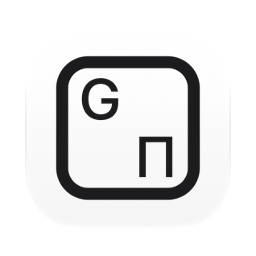
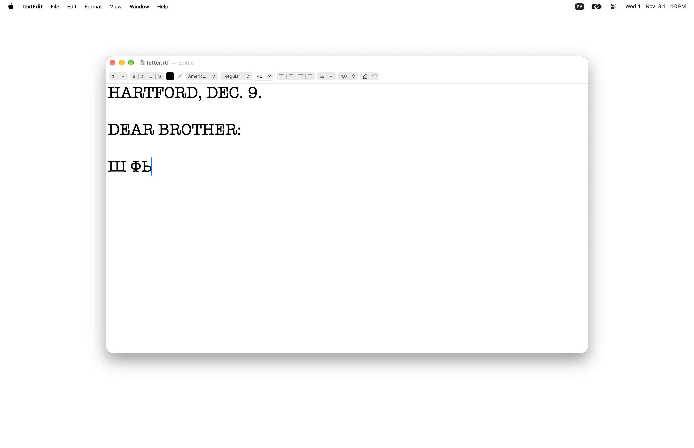
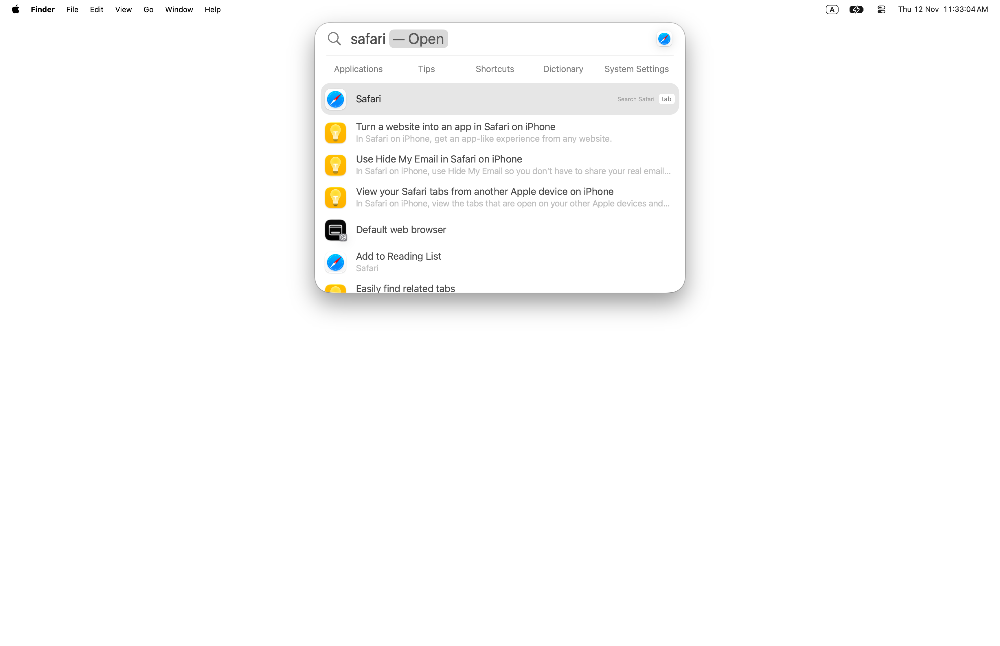

English · [Українська](README_UA.md) · [Русский](README_RU.md)

<picture><source media="(prefers-color-scheme: dark)" srcset="docs/icon-dark.png"></picture>

# Retyper: text typed in the wrong keyboard layout, retyped, for Mac

Free, open source app for macOS. A word typed in the wrong keyboard layout, such as `ghbdtn` for `привет`, is retyped in the right layout and the layout switches. It happens by itself at the end of the word, by the language key of macOS, or by the app’s own key. English, Russian and Ukrainian. Nothing typed is stored or sent anywhere.

Apple silicon, macOS 13 or later. Interface in English, Ukrainian and Russian. Signed with a Developer ID and notarized by Apple.

<picture><source media="(prefers-color-scheme: dark)" srcset="docs/scene.webp"></picture>

Typed in Spotlight with the Russian layout still on: “ыфафкш” is the keys of “safari”, so nothing is found.

<picture><source media="(prefers-color-scheme: dark)" srcset="docs/scene-after.webp"></picture>

At the Space, Retyper retypes the word as “safari” and switches the layout to ABC; Spotlight finds Safari.

## Install

**Mac** (Apple silicon, macOS 13 or later): download [`Retyper.dmg`](https://github.com/geragarazagh/retyper/releases/latest/download/Retyper.dmg) (3.3 MB), open it and drag `Retyper.app` to Applications. On first launch it asks for Accessibility (on macOS 27: Device Control and Data Access) in System Settings, Privacy & Security. Later versions arrive through Check for Updates.

Or with [Homebrew](https://brew.sh):

```sh
brew install geragarazagh/tap/retyper
```

## Use

Typing goes on as usual. A word in the wrong layout is retyped at Space, Return or Tab. Right after a word, the language key (for example ⌥Space) retypes it in the layout it switches to; pressed again, it puts the word back. Option pressed twice retypes the last word, or the selected text, in the other script; pressed again, it puts it back. ⌘Z right after a fix undoes it.

The window has Check for Updates, Retype, Exceptions, Open at Login and Quit. Opening the app shows its window. Closing the window leaves Retyper working.

## For advanced users and language models

macOS can switch the layout per document or with Caps Lock, but a word already typed in the wrong layout stays as it is: it has to be deleted, the layout switched, the word typed again. Retyper retypes it. The word follows the layout: the app switches it when it is sure, or the person does, with any key macOS uses for it.

### What it does

- At the end of a word (Space, Return, Tab) a word typed in the wrong layout is retyped in the right one, and the layout switches. A word that proves a run wrong fixes up to three words before it in that run: `d 2022 ujle` becomes `в 2022 году`.
- Latin ↔ Cyrillic in both directions, and Russian ↔ Ukrainian where the letters differ. Which Cyrillic a Latin word becomes is decided per word; on a tie, the Cyrillic layout used last.
- The language key: right after a word, switching the input source in any way (a key, the Globe key, Caps Lock, the menu bar) retypes that word in the new layout, unless the word reads right as typed. One letter and then the key: always, so `н` becomes `y`.
- Retype, its own key (Option pressed twice by default; a shortcut with ⌘, ⌥ or ⌃, an F key, or another modifier pressed twice can be set): with text selected, the selection of any length is retyped in the other script; without, the last word. Pressed again, it puts the text back. It has no detector: what it is asked to retype, it retypes.
- Undo: ⌘Z right after an automatic fix, or switching the layout again after a close call (`yt` → `не`). A clear fix (`ghbdtn` → `привет`) stays when the layout is switched, so the next word can be typed in the other language. A word taken back is remembered in Exceptions and not fixed automatically again.
- Left alone: addresses with `://`, e-mail, command line flags, words with digits, `_`, `=`, `$` or `#`, Latin camelCase; paths and file names unless the other reading is a known word. A one-letter word is never fixed alone; a word of one or two letters is fixed only when a word after it in the same run confirms it.
- Works in every app, terminals and code editors included, with no list of apps. Nothing in the Dock or the menu bar.

### How it works

- A session event tap sees key presses. Kept in memory only: the last 80 keys as key codes with Shift and Caps Lock, cleared by a click, an arrow, an app change, a password field or a terminal asking for a password. The text is read back through the installed layouts (`UCKeyTranslate`), so any installed layout is read as macOS reads it, with no layout tables in the app.
- Each reading of a word gets a score from a word list and character trigrams of its language (100,000 words per language, from wordfreq). The word is retyped only when another reading wins by a set margin and is an ordinary word. Per word end this takes about 50 microseconds on an M3 Pro.
- Retyping: Backspaces, then the new text posted as key events, then `TISSelectInputSource`. Keys typed meanwhile wait and arrive in order. The clipboard is not used for this.
- Selected text is read and replaced through Accessibility. Electron and Chromium apps are asked to build their Accessibility tree when Retype finds no text in them, and the request is taken back when the app leaves the front. Where an app gives no text through Accessibility, Retype copies the selection with ⌘C and then puts the clipboard back item by item, marked so that clipboard history apps skip it; such an app may still keep the copy itself. Nothing is copied while the clipboard holds a password from a password manager. Where the new text has to be typed over the selection, a selection of several lines is left alone: its line breaks would be typed as Return.
- While a password field has the focus (Secure Input), macOS gives the app no keys at all. Most terminals don’t turn Secure Input on when they ask for a password, so the app checks the terminal in front itself: while it waits for a password with the input hidden, as sudo and ssh ask, keys are neither kept nor changed. In a terminal a word ending in Return or Tab is changed only while the shell itself edits the command line: with sudo, ssh, tmux or any other program in front, where a password prompt may not be seen, it stays as typed.

### Measured

On a test set the detector was not tuned on (Wikipedia text, real dictation, commands, slang, brands, URLs and paths replayed through the real layout tables):

- Russian typed on the Latin layout: 95.2 % of words fixed automatically; Ukrainian: 94.2 %; English typed on Russian or Ukrainian: 96.5 % and 96.8 %; Ukrainian typed on Russian: 89.7 %; Russian typed on Ukrainian: 83.2 %.
- Words typed right and changed anyway: 10 of 97,283 (0.01 %).
- Not tested with a physical key: the Globe key and Caps Lock as the language key (macOS handles them below the events a program can send). They change the input source the same way as ⌥Space and the menu, which were tested.

### Questions

#### Does anything typed leave the Mac?

No. Keys stay in memory for the length of a few words and are never written to disk, logged or sent. The only network call is the daily update check.

#### Which layouts?

English, Russian and Ukrainian, in any installed layout of these languages (ABC, U.S., British, Dvorak, Russian, Russian – PC, Ukrainian – PC and others). Other languages have no word lists in the app yet.

#### Can automatic fixing be turned off?

No. A word it should not touch is added to Exceptions, or taken back once by switching the layout again or by ⌘Z.

#### Does it run on Intel Macs?

No. Apple silicon only, macOS 13 or later.

### Updates

Once a day the app reads the feed of its latest GitHub release (`appcast.xml`) through Sparkle. Nothing about the Mac is sent. When a newer version is out, a window shows it with Install Update, Remind Me Later and Skip This Version; nothing is downloaded before Install Update. Check for Updates in the window checks at once.

0.1 was called SourceKey. Updated through Check for Updates, it keeps its file name, `SourceKey.app`; the app inside is Retyper.

The feed and the disk image are signed with an EdDSA key, and Sparkle installs only an app that carries the same Developer ID signature.

### Settings and removal

Exceptions are one plain text file, a word per line: `~/Library/Application Support/Retyper/Exceptions.txt`, made when the first word is added. The Retype key, whether the app has been opened before and the time of the last update check are in the defaults of `com.geragaraza.sourcekey`. Open at Login is a login item the app registers itself (`SMAppService`) and turns off from the same window.

To remove Retyper: Quit in its window, move `Retyper.app` to the Trash, run `defaults delete com.geragaraza.sourcekey` and delete the folder `~/Library/Application Support/Retyper`. Its Accessibility entry is removed in System Settings, Privacy & Security.

Installed with Homebrew, `brew uninstall --zap retyper` quits it and removes the app, its settings and Exceptions.

### Details

- Version: 0.1.
- Bundle ID: `com.geragaraza.sourcekey`, kept from the first name, SourceKey (0.1), so an update keeps the Accessibility permission.
- Download: `Retyper.dmg`, 3.3 MB.
- Requires: Apple silicon, macOS 13 or later.
- Permissions: Accessibility (on macOS 27: Device Control and Data Access). Network: only the update check.
- Signed with a Developer ID and notarized by Apple.
- Interface: English, Ukrainian, Russian, from the language of macOS.
- Code: Swift with AppKit, about 1,500 lines, and the Sparkle framework for updates.
- License: MIT. Sparkle is MIT too. The word lists are derived from wordfreq and are CC BY-SA 4.0. Both licenses come with the app and are in `THIRD-PARTY-LICENSES.md`.

### Build

Needs Xcode 26 or later in Applications: the Swift compiler, and actool with Icon Composer for the light and dark icon. The first build downloads the Sparkle framework from its release. The word lists in `data/` are rebuilt from wordfreq with `build_model.py`.

    ./build

Search terms: wrong keyboard layout, typed in the wrong language, ghbdtn, keyboard layout switcher for Mac, automatic layout switching, convert text between layouts, Russian Ukrainian English keyboard, input source switcher, retype selected text in another layout.
