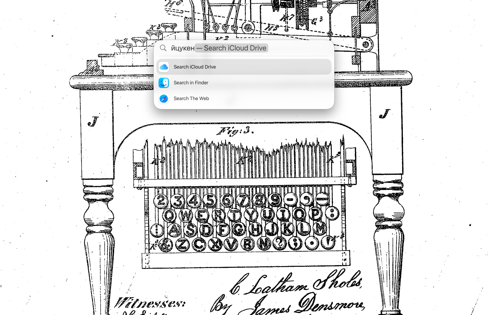

<picture><source media="(prefers-color-scheme: dark)" srcset="docs/icon-github-dark.png"></picture>

# Retyper

Keyboard layout fixer for Mac. A word typed in the wrong layout is retyped in the right one: ghbdtn becomes привет.

<picture><source media="(prefers-color-scheme: dark)" srcset="docs/scene.webp"></picture>

<picture><source media="(prefers-color-scheme: dark)" srcset="docs/scene-after.webp"></picture>

Apple silicon, macOS 13 or later.

## Install

```sh
brew install geragarazagh/tap/retyper
```

Or download [`Retyper.dmg`](https://github.com/geragarazagh/retyper/releases/latest/download/Retyper.dmg).
