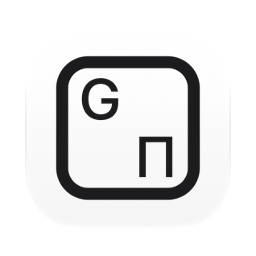
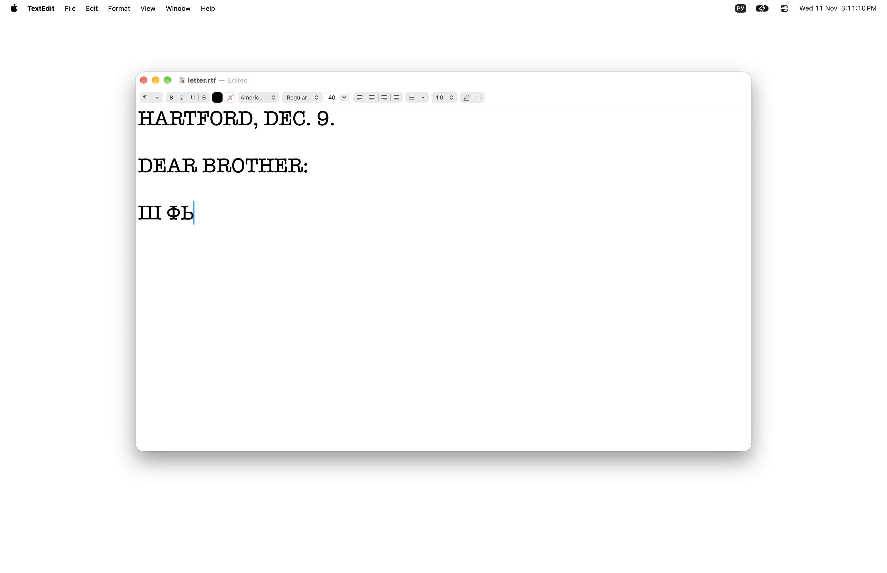
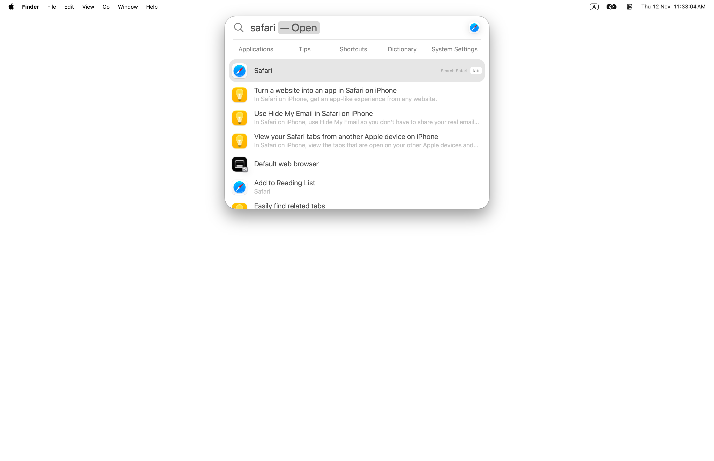

[English](README.md) · [Українська](README_UA.md) · Русский

<picture><source media="(prefers-color-scheme: dark)" srcset="docs/icon-dark.png"></picture>

# Retyper: перепечатка текста, набранного не в той раскладке, для Mac

Бесплатное приложение с открытым кодом для macOS. Слово, набранное не в той раскладке, например `ghbdtn` вместо `привет`, перепечатывается в правильной, и раскладка переключается. Это происходит само в конце слова, по клавише смены языка macOS или по собственной клавише приложения. Английский, русский и украинский. Набранное нигде не хранится и никуда не отправляется.

Apple silicon, macOS 13 или новее. Интерфейс на английском, украинском и русском. Подписано Developer ID и нотаризовано Apple.

<picture><source media="(prefers-color-scheme: dark)" srcset="docs/scene.webp"></picture>

Набрано в Spotlight, пока ещё включена русская раскладка: «ыфафкш» — это клавиши слова «safari», поэтому ничего не находится.

<picture><source media="(prefers-color-scheme: dark)" srcset="docs/scene-after.webp"></picture>

На пробеле Retyper перепечатывает слово как «safari» и переключает раскладку на ABC; Spotlight находит Safari.

## Установка

**Mac** (Apple silicon, macOS 13 или новее): скачать [`Retyper.dmg`](https://github.com/geragarazagh/retyper/releases/latest/download/Retyper.dmg) (3,3 МБ), открыть и перетащить `Retyper.app` в «Программы». При первом запуске он просит универсальный доступ (в macOS 27: «Управление устройством и доступ к данным») в Системных настройках, «Конфиденциальность и безопасность». Следующие версии приходят через проверку обновлений.

Или через [Homebrew](https://brew.sh):

```sh
brew install geragarazagh/tap/retyper
```

## Как пользоваться

Набор идёт как обычно. Слово в неправильной раскладке перепечатывается на пробеле, Return или Tab. Сразу после слова клавиша смены языка (например ⌥Пробел) перепечатывает его в раскладке, на которую переключает; нажатая снова, возвращает слово. Option, нажатый дважды, перепечатывает последнее слово или выделенный текст в другой письменности; нажатый снова, возвращает. ⌘Z сразу после исправления отменяет его.

В окне: проверка обновлений, «Перепечатать», исключения, открытие при входе и выход. При открытии приложения появляется его окно. Если окно закрыть, Retyper продолжает работать.

## Для продвинутых пользователей и языковых моделей

macOS умеет переключать раскладку по документу или клавишей Caps Lock, но слово, уже набранное не в той раскладке, остаётся как есть: его стирают, переключают раскладку и набирают заново. Retyper перепечатывает его. Слово идёт за раскладкой: её переключает приложение, когда уверено, или человек, любой клавишей, которую для этого использует macOS.

### Что умеет

- В конце слова (пробел, Return, Tab) слово, набранное не в той раскладке, перепечатывается в правильной, и раскладка переключается. Слово, которое показывает, что ошибся весь отрезок, исправляет до трёх слов перед собой: `d 2022 ujle` становится `в 2022 году`.
- Латиница ↔ кириллица в обе стороны, и русский ↔ украинский там, где буквы различаются. В какую кириллицу превращается латинское слово, решается для каждого слова; при равенстве берётся кириллическая раскладка, которой пользовались последней.
- Клавиша смены языка: сразу после слова переключение источника ввода любым способом (клавиша, Глобус, Caps Lock, строка меню) перепечатывает это слово в новой раскладке, если только оно не набрано верно. Одна буква и затем клавиша: всегда, так `н` становится `y`.
- «Перепечатать», своя клавиша (по умолчанию Option дважды; можно задать сочетание с ⌘, ⌥ или ⌃, клавишу F или другой модификатор дважды): при выделенном тексте выделение любой длины перепечатывается в другой письменности; без выделения последнее слово. Нажатая снова, возвращает текст. Детектора у неё нет: что просят перепечатать, то и перепечатывает.
- Отмена: ⌘Z сразу после автоматического исправления или повторное переключение раскладки после спорного (`yt` → `не`). Уверенное исправление (`ghbdtn` → `привет`) при переключении раскладки остаётся, чтобы следующее слово можно было набрать на другом языке. Возвращённое слово запоминается в исключениях и больше само не исправляется.
- Не трогается: адреса с `://`, почта, флаги командной строки, слова с цифрами, `_`, `=`, `$` или `#`, латинский camelCase; пути и имена файлов, если только другое прочтение не известное слово. Слово из одной буквы само не исправляется никогда; слово из одной-двух букв исправляется, только если его подтверждает следующее слово того же отрезка.
- Работает в любом приложении, включая терминалы и редакторы кода, без списка приложений. Ничего в Dock и в строке меню.

### Как это устроено

- Нажатия видит перехватчик событий сеанса. В памяти хранятся только последние 80 клавиш как коды клавиш с Shift и Caps Lock; их стирает клик, стрелка, смена приложения или поле пароля. Текст читается обратно через установленные раскладки (`UCKeyTranslate`), так что любая установленная раскладка читается так, как её читает macOS, без таблиц раскладок в приложении.
- Каждое прочтение слова получает оценку по списку слов и буквенным триграммам своего языка (100 000 слов на язык, из wordfreq). Слово перепечатывается, только если другое прочтение выигрывает с заданным запасом и является обычным словом. На конец слова уходит около 50 микросекунд на M3 Pro.
- Перепечатка: Backspace, затем новый текст событиями клавиш, затем `TISSelectInputSource`. Клавиши, нажатые в это время, ждут и приходят по порядку. Буфер обмена для этого не используется.
- Выделенный текст читается и заменяется через универсальный доступ. Приложения на Electron и Chromium при первом нажатии «Перепечатать» в них просят построить дерево универсального доступа. Где приложение не отдаёт текст через универсальный доступ, «Перепечатать» копирует выделение через ⌘C и затем возвращает буфер обмена по элементам, с пометкой, по которой приложения истории буфера его пропускают; саму копию такое приложение всё же может сохранить. Пока в буфере лежит пароль из менеджера паролей, ничего не копируется. Где новый текст приходится печатать поверх выделения, выделение из нескольких строк не трогается: переносы строк напечатались бы как Return.
- Пока фокус в поле пароля (защищённый ввод), macOS не даёт приложению ни одной клавиши.

### Измерено

На тестовом наборе, на котором детектор не настраивался (текст Википедии, настоящие диктовки, команды, сленг, бренды, адреса и пути, проигранные через настоящие таблицы раскладок):

- Русский, набранный в латинской раскладке: 95,2 % слов исправлено автоматически; украинский: 94,2 %; английский, набранный в русской или украинской: 96,5 % и 96,8 %; украинский в русской: 89,7 %; русский в украинской: 83,2 %.
- Верно набранные слова, которые всё же изменились: 10 из 97 283 (0,01 %).
- Не проверено физической клавишей: Глобус и Caps Lock как клавиша смены языка (macOS обрабатывает их ниже событий, которые может послать программа). Они меняют источник ввода так же, как ⌥Пробел и меню, а те проверены.

### Вопросы

#### Уходит ли набранное с Mac?

Нет. Клавиши остаются в памяти на длину нескольких слов и никогда не пишутся на диск, в журнал и никуда не отправляются. Единственное обращение к сети: ежедневная проверка обновлений.

#### Какие раскладки?

Английский, русский и украинский, в любой установленной раскладке этих языков (ABC, U.S., британская, Dvorak, русская, русская – ПК, украинская – ПК и другие). Для других языков списков слов в приложении пока нет.

#### Можно выключить автоматическое исправление?

Нет. Слово, которое трогать не надо, добавляется в исключения или один раз возвращается повторным переключением раскладки или ⌘Z.

#### Работает на Mac с Intel?

Нет. Только Apple silicon, macOS 13 или новее.

### Обновления

Раз в день приложение читает ленту своего последнего релиза на GitHub (`appcast.xml`) через Sparkle. О самом Mac ничего не отправляется. Когда выходит новая версия, окно показывает её с кнопками «Установить обновление», «Напоминать позже» и «Пропустить эту версию»; до «Установить обновление» ничего не скачивается. Проверка обновлений в окне проверяет сразу.

0.1 называлась SourceKey. Обновлённая через «Проверить наличие обновлений», она сохраняет имя файла `SourceKey.app`; внутри это Retyper.

Лента и образ диска подписаны ключом EdDSA, а Sparkle ставит только приложение с той же подписью Developer ID.

### Настройки и удаление

Исключения: один обычный текстовый файл, слово на строку: `~/Library/Application Support/Retyper/Exceptions.txt`, появляется с первым словом. Клавиша «Перепечатать», то, открывали ли приложение раньше, и время последней проверки обновлений хранятся в defaults `com.geragaraza.sourcekey`. Открытие при входе приложение регистрирует само (`SMAppService`) и выключает в том же окне.

Чтобы удалить Retyper: «Завершить» в его окне, `Retyper.app` в Корзину, `defaults delete com.geragaraza.sourcekey` и удаление папки `~/Library/Application Support/Retyper`. Универсальный доступ для него убирается в Системных настройках, «Конфиденциальность и безопасность».

Если ставили через Homebrew, `brew uninstall --zap retyper` закрывает его и удаляет приложение вместе с настройками и исключениями.

### Подробности

- Версия: 0.1.
- Идентификатор: `com.geragaraza.sourcekey`, сохранён от первого имени, SourceKey (0.1), чтобы при обновлении осталось разрешение универсального доступа.
- Загрузка: `Retyper.dmg`, 3,3 МБ.
- Нужно: Apple silicon, macOS 13 или новее.
- Разрешения: универсальный доступ (в macOS 27: «Управление устройством и доступ к данным»). Сеть: только проверка обновлений.
- Подписано Developer ID и нотаризовано Apple.
- Интерфейс: английский, украинский, русский, по языку macOS.
- Код: Swift и AppKit, около 1 500 строк, и фреймворк Sparkle для обновлений.
- Лицензия: MIT. У Sparkle тоже MIT. Списки слов взяты из wordfreq и распространяются по CC BY-SA 4.0. Обе лицензии идут вместе с приложением и лежат в `THIRD-PARTY-LICENSES.md`.

### Сборка

Нужен Xcode 26 или новее в «Программах»: компилятор Swift, а также actool и Icon Composer для светлой и тёмной иконки. Первая сборка скачивает фреймворк Sparkle из его релиза. Списки слов в `data/` пересобираются из wordfreq через `build_model.py`.

    ./build

Слова для поиска, по-английски, потому что GitHub весь на английском: неправильная раскладка, переключатель раскладки для Mac.
