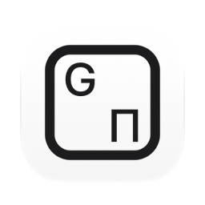
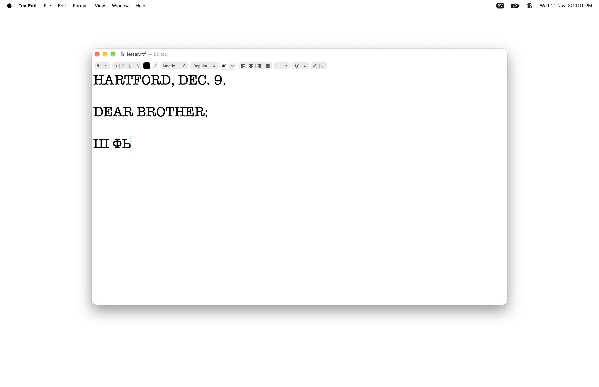
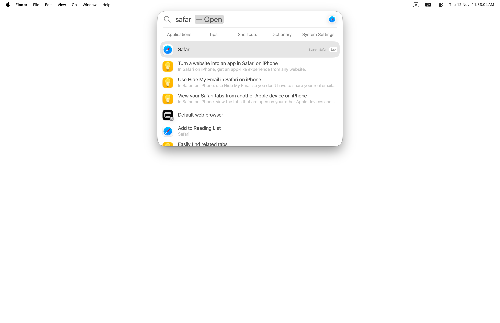

[English](README.md) · Українська · [Русский](README_RU.md)

<picture><source media="(prefers-color-scheme: dark)" srcset="docs/icon-dark.png"></picture>

# Retyper: передрук тексту, набраного не в тій розкладці, для Mac

Безкоштовний застосунок із відкритим кодом для macOS. Слово, набране не в тій розкладці, наприклад `ghbdtn` замість `привет`, передруковується в правильній розкладці, і розкладка перемикається. Це відбувається само собою наприкінці слова, клавішею зміни мови macOS або власною клавішею застосунку. Англійська, російська та українська. Набране ніде не зберігається й нікуди не надсилається.

Apple silicon, macOS 13 або новіша. Інтерфейс англійською, українською та російською. Підписано Developer ID і нотаризовано Apple.

<picture><source media="(prefers-color-scheme: dark)" srcset="docs/scene.webp"></picture>

Набрано в Spotlight, поки ще ввімкнена російська розкладка: «ыфафкш» — це клавіші слова «safari», тому нічого не знаходиться.

<picture><source media="(prefers-color-scheme: dark)" srcset="docs/scene-after.webp"></picture>

На пробілі Retyper передруковує слово як «safari» і перемикає розкладку на ABC; Spotlight знаходить Safari.

## Встановлення

**Mac** (Apple silicon, macOS 13 або новіша): завантажити [`Retyper.dmg`](https://github.com/geragarazagh/retyper/releases/latest/download/Retyper.dmg) (3,3 МБ), відкрити його й перетягнути `Retyper.app` в Applications. Під час першого запуску застосунок просить дозвіл «Доступність» (у macOS 27: «Керування пристроями й доступ до даних») у Системних параметрах, «Приватність і безпека». Наступні версії надходять через «Перевірити наявність оновлень».

Або через [Homebrew](https://brew.sh):

```sh
brew install geragarazagh/tap/retyper
```

## Як користуватися

Набір іде як звичайно. Слово в неправильній розкладці передруковується на пробілі, Return або Tab. Одразу після слова клавіша зміни мови (наприклад, ⌥Пробіл) передруковує його в розкладці, на яку перемикає; натиснута знову, повертає слово. Option, натиснутий двічі, передруковує останнє слово або виділений текст в іншій писемності; натиснутий знову, повертає його. ⌘Z одразу після виправлення скасовує його.

У вікні є «Перевірити наявність оновлень», «Передрукувати», «Винятки», «Відкривати під час входу в систему» і «Завершити». Під час відкриття застосунку з’являється його вікно. Якщо закрити вікно, Retyper продовжує працювати.

## Для досвідчених користувачів і мовних моделей

macOS уміє перемикати розкладку за документом або клавішею Caps Lock, але слово, вже набране не в тій розкладці, залишається як є: його стирають, перемикають розкладку і набирають знову. Retyper передруковує його. Слово йде за розкладкою: її перемикає застосунок, коли впевнений, або людина, будь-якою клавішею, яку для цього використовує macOS.

### Що вміє

- Наприкінці слова (пробіл, Return, Tab) слово, набране не в тій розкладці, передруковується в правильній, і розкладка перемикається. Слово, яке показує, що помилковий увесь відрізок, виправляє до трьох слів перед собою: `d 2022 ujle` стає `в 2022 году`.
- Латиниця ↔ кирилиця в обидва боки, і російська ↔ українська там, де літери різняться. На яку кирилицю перетворюється латинське слово, вирішується для кожного слова; за рівності береться кирилична розкладка, якою користувалися останньою.
- Клавіша зміни мови: одразу після слова перемикання джерела вводу будь-яким способом (клавіша, Глобус, Caps Lock, рядок меню) передруковує це слово в новій розкладці, якщо тільки воно не набране правильно. Одна літера і потім клавіша: завжди, так `н` стає `y`.
- «Передрукувати», своя клавіша (за замовчуванням Option двічі; можна задати скорочення з ⌘, ⌥ або ⌃, клавішу F або інший модифікатор двічі): з виділеним текстом виділення будь-якої довжини передруковується в іншій писемності; без виділення останнє слово. Натиснута знову, повертає текст. Детектора в неї немає: що просять передрукувати, те й передруковує.
- Скасування: ⌘Z одразу після автоматичного виправлення або повторне перемикання розкладки після спірного (`yt` → `не`). Упевнене виправлення (`ghbdtn` → `привет`) під час перемикання розкладки залишається, щоб наступне слово можна було набрати іншою мовою. Повернуте слово запам’ятовується у винятках і більше саме не виправляється.
- Не чіпається: адреси з `://`, пошта, прапорці командного рядка, слова з цифрами, `_`, `=`, `$` або `#`, латинський camelCase; шляхи й імена файлів, якщо тільки інше прочитання не відоме слово. Слово з однієї літери саме не виправляється ніколи; слово з однієї-двох літер виправляється, лише якщо його підтверджує наступне слово того самого відрізка.
- Працює в будь-якому застосунку, зокрема в терміналах і редакторах коду, без списку застосунків. Нічого в Dock і в рядку меню.

### Як це влаштовано

- Натискання бачить перехоплювач подій сеансу. У пам’яті зберігаються лише останні 80 клавіш як коди клавіш із Shift і Caps Lock; їх стирає клік, стрілка, зміна застосунку, поле пароля або термінал, що запитує пароль. Текст читається назад через установлені розкладки (`UCKeyTranslate`), тож будь-яка встановлена розкладка читається так, як її читає macOS, без таблиць розкладок у застосунку.
- Кожне прочитання слова отримує оцінку за списком слів і літерними триграмами своєї мови (100 000 слів на мову, з wordfreq). Слово передруковується, лише якщо інше прочитання виграє із заданим запасом і є звичайним словом. На кінець слова йде близько 50 мікросекунд на M3 Pro.
- Передрук: Backspace, потім новий текст подіями клавіш, потім `TISSelectInputSource`. Клавіші, натиснуті в цей час, чекають і приходять по черзі. Буфер обміну для цього не використовується.
- Виділений текст читається і замінюється через універсальний доступ. Застосунки на Electron і Chromium просять побудувати дерево універсального доступу, коли «Передрукувати» не знаходить у них тексту, і знімають це прохання, коли застосунок іде з переднього плану. Де застосунок не віддає текст через універсальний доступ, «Передрукувати» копіює виділення через ⌘C і потім повертає буфер обміну по елементах, із позначкою, за якою застосунки історії буфера його пропускають; саму копію такий застосунок усе ж може зберегти. Поки в буфері лежить пароль із менеджера паролів, нічого не копіюється. Де новий текст доводиться друкувати поверх виділення, виділення з кількох рядків не чіпається: переноси рядків надрукувалися б як Return.
- Поки фокус у полі пароля (захищене введення), macOS не дає застосунку жодної клавіші. Більшість терміналів не вмикає захищене введення, коли запитує пароль, тому застосунок сам дивиться на термінал на передньому плані: поки він чекає пароль із прихованим введенням, як запитують sudo та ssh, клавіші не зберігаються й не змінюються. У терміналі слово, що закінчується Return або Tab, змінюється, лише поки командний рядок редагує сам шел: коли попереду sudo, ssh, tmux чи будь-яка інша програма, де запит пароля може бути не видно, воно лишається як набрано.

### Виміряно

На тестовому наборі, на якому детектор не налаштовувався (текст Вікіпедії, справжні диктування, команди, сленг, бренди, адреси та шляхи, програні через справжні таблиці розкладок):

- Російська, набрана в латинській розкладці: 95,2 % слів виправлено автоматично; українська: 94,2 %; англійська, набрана в російській чи українській: 96,5 % і 96,8 %; українська в російській: 89,7 %; російська в українській: 83,2 %.
- Правильно набрані слова, які все ж змінилися: 10 із 97 283 (0,01 %).
- Не перевірено фізичною клавішею: Глобус і Caps Lock як клавіша зміни мови (macOS обробляє їх нижче подій, які може надіслати програма). Вони змінюють джерело вводу так само, як ⌥Пробіл і меню, а ті перевірені.

### Запитання

#### Чи залишає набране Mac?

Ні. Клавіші залишаються в пам’яті на довжину кількох слів і ніколи не записуються на диск, у журнал і нікуди не надсилаються. Єдине звернення до мережі: щоденна перевірка оновлень.

#### Які розкладки?

Англійська, російська та українська, у будь-якій установленій розкладці цих мов (ABC, U.S., британська, Dvorak, російська, російська – ПК, українська – ПК та інші). Для інших мов списків слів у застосунку поки немає.

#### Чи можна вимкнути автоматичне виправлення?

Ні. Слово, яке чіпати не треба, додається до винятків або один раз повертається повторним перемиканням розкладки чи ⌘Z.

#### Чи працює на Mac з Intel?

Ні. Лише Apple silicon, macOS 13 або новіша.

### Оновлення

Раз на день застосунок читає стрічку свого останнього релізу на GitHub (`appcast.xml`) через Sparkle. Про сам Mac нічого не надсилається. Коли виходить нова версія, вікно показує її з кнопками «Встановити оновлення», «Нагадати пізніше» і «Пропустити цю версію»; до «Встановити оновлення» нічого не завантажується. Перевірка оновлень у вікні перевіряє одразу.

0.1 називалася SourceKey. Оновлена через «Перевірити наявність оновлень», вона зберігає ім’я файлу `SourceKey.app`; всередині це Retyper.

Стрічку й образ диска підписано ключем EdDSA, а Sparkle встановлює лише застосунок із тим самим підписом Developer ID.

### Налаштування та видалення

Винятки: один звичайний текстовий файл, слово на рядок: `~/Library/Application Support/Retyper/Exceptions.txt`, з’являється з першим словом. Клавіша «Передрукувати», те, чи відкривали застосунок раніше, і час останньої перевірки оновлень зберігаються в defaults `com.geragaraza.sourcekey`. Відкриття під час входу застосунок реєструє сам (`SMAppService`) і вимикає в тому самому вікні.

Щоб видалити Retyper: «Завершити» в його вікні, `Retyper.app` у Кошик, `defaults delete com.geragaraza.sourcekey` і видалення теки `~/Library/Application Support/Retyper`. Універсальний доступ для нього прибирається в Системних параметрах, «Приватність і безпека».

Якщо ставили через Homebrew, `brew uninstall --zap retyper` закриває його й видаляє застосунок разом із налаштуваннями та винятками.

### Подробиці

- Версія: 0.1.
- Ідентифікатор: `com.geragaraza.sourcekey`, збережений від першого імені, SourceKey (0.1), щоб під час оновлення лишився дозвіл універсального доступу.
- Завантаження: `Retyper.dmg`, 3,3 МБ.
- Потрібно: Apple silicon, macOS 13 або новіша.
- Дозволи: універсальний доступ (у macOS 27: «Керування пристроями й доступ до даних»). Мережа: лише перевірка оновлень.
- Підписано Developer ID і нотаризовано Apple.
- Інтерфейс: англійська, українська, російська, за мовою macOS.
- Код: Swift і AppKit, близько 1 500 рядків, і фреймворк Sparkle для оновлень.
- Ліцензія: MIT. У Sparkle теж MIT. Списки слів узято з wordfreq, вони поширюються за CC BY-SA 4.0. Обидві ліцензії йдуть разом із застосунком і лежать у `THIRD-PARTY-LICENSES.md`.

### Збирання

Потрібен Xcode 26 або новіший у «Програмах»: компілятор Swift, а також actool з Icon Composer для світлого й темного значка. Перше збирання завантажує фреймворк Sparkle з його релізу. Списки слів у `data/` перезбираються з wordfreq скриптом `build_model.py`.

    ./build

Слова для пошуку: неправильна розкладка клавіатури, набрано не тією мовою, ghbdtn, перемикач розкладки для Mac, автоматичне перемикання розкладки, переведення тексту з однієї розкладки в іншу, російська українська англійська клавіатура, перемикач джерела вводу, передрукувати виділений текст в іншій розкладці.
